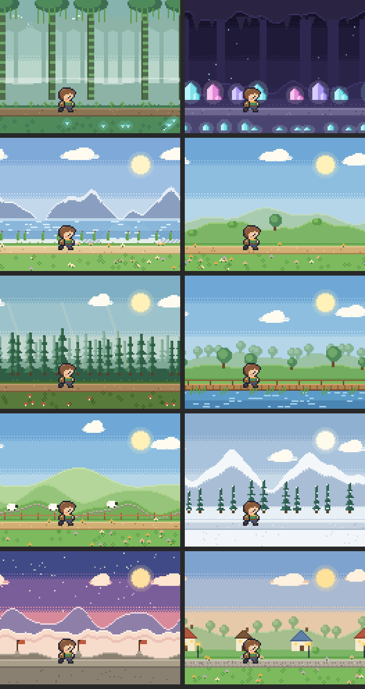

# Walkscape

*Every step takes you somewhere. Explore the world together.*

Walkscape is a cozy pixel-art walking game for iPhone. Apple Health step and
walking-distance totals move your character through a continuous world: each
kilometre walked today reaches a new zone, from Sunny Meadow up to the Summit and down
the far side to Lighthouse Point (20 km).
Friends share a daily track ordered by distance walked. The game never uses
location.



## Status

| Milestone | State |
|---|---|
| 1. Foundation: design system, 4-tab shell, Journey screen, pixel-art scenes | ✅ implemented |
| 2. Walking: HealthKit service, mock provider, zone progression, boundary celebrations | ✅ implemented (needs device testing) |
| 3. Social track: viewport fitting, edge indicators, focus, Back to me | ✅ implemented with mock friends |
| 4. Backend: Supabase auth, friendships, progress sync, RLS | ✅ implemented. Needs a Supabase project, see [`docs/BACKEND.md`](docs/BACKEND.md) |
| 5–7. Game depth, beta, monetisation | ⏳ not started |

See [`docs/CHECKLIST.md`](docs/CHECKLIST.md) for the detailed task list.

## Requirements

- macOS with **Xcode 16 or later** (iOS 17 SDK minimum; the app targets iOS 17.0)
- [XcodeGen](https://github.com/yonaskolb/XcodeGen): `brew install xcodegen`
- An Apple Developer account to run on a physical iPhone with HealthKit.
  The simulator works with demo data and needs no account.

## Build and run

```sh
cd Walkscape
xcodegen generate          # creates Walkscape.xcodeproj from project.yml
open Walkscape.xcodeproj
```

In Xcode:

1. Select the **Walkscape** target → *Signing & Capabilities* → choose your team.
   The bundle identifier is `com.alexandrub.walkscape`.
2. Check that the **HealthKit** capability is listed with *Background Delivery*
   ticked (it comes from `Walkscape/Resources/Walkscape.entitlements`).
3. Run on an iPhone simulator. The simulator defaults to **demo data**, which
   is clearly labelled in the UI. Use the *Demo mode* card on the Journey
   screen to simulate walking and see zone transitions.
4. On a physical iPhone the app defaults to Apple Health and asks for read
   access to Steps and Walking + Running Distance.

The Xcode project is generated, not committed. Re-run `xcodegen generate`
after adding or removing files.

## Tests

The game logic lives in a Swift package that has no UIKit or SwiftUI
dependency, so it can be tested anywhere:

```sh
cd Walkscape/Packages/WalkscapeKit
swift test
```

The same tests run on Linux in Docker:

```sh
docker run --rm -v "$PWD":/pkg -w /pkg swift:6.0-noble swift test
```

There are 81 tests covering kilometre boundaries (0, 999, 1,000, 1,999, 2,000
and very large distances), local-day resets and DST, late and duplicate
updates, idempotent unlocks, the friend-track layout (narrow spreads,
far-ahead and far-behind friends, grouping, focus, Back to me, equal
distances, empty lists, huge distances, stale and unavailable friends,
determinism and stability), the leaderboard, the mock repositories, the
pixel-art renderer and the Supabase client (sign-in, token refresh, error
mapping, duplicate-sync prevention).

The Supabase schema has its own tests (64 checks for row level security,
friendship rules and sync), run against real Postgres:

```sh
Walkscape/supabase/tests/run.sh    # needs Docker
```

CI (`.github/workflows/walkscape.yml` at the repo root) runs the package tests
and database tests on Linux, and builds the iOS app for the simulator on macOS.

### Previewing the art without a simulator

```sh
cd Walkscape/Packages/WalkscapeKit
swift run pixel-preview preview-output
```

This writes PPM images of every scene, the character sheet and the item icons.

## Architecture

```
Walkscape/
├── project.yml                 XcodeGen spec (source of truth for the Xcode project)
├── Config/                     xcconfig files (Supabase connection; secrets are git-ignored)
├── supabase/                   SQL migrations and database tests
├── Packages/WalkscapeKit/      Pure-Swift package, builds and tests on any platform
│   ├── Sources/WalkscapeDomain
│   │   ├── Models/             DailyProgress, FriendSummary, LocalDay, UserID, avatars
│   │   ├── ZoneProgression/    Zone catalog, progression engine, persisted state, achievements
│   │   ├── FriendTrack/        Track layout engine, focus controller, leaderboard
│   │   ├── Services/           WalkingDataProvider / FriendRepository protocols, sync status
│   │   ├── Mock/               Deterministic demo walking data and sample friends
│   │   └── Utilities/          Distance formatting
│   ├── Sources/PixelArt        Pixel canvas, sprite format, characters, items, biome scenes
│   ├── Sources/WalkscapeBackend  Dependency-free Supabase client: auth, RPC, friends, sync
│   ├── Sources/PixelPreview    Command-line art previewer
│   └── Tests/
└── Walkscape/                  The iOS app (SwiftUI)
    ├── App/                    Entry point and AppModel (app-wide state)
    ├── Core/DesignSystem/      Theme tokens, panels, buttons, progress bars, chips
    ├── Core/Navigation/        Four-tab shell
    ├── Core/Utilities/         Pixel art → CGImage, sprite cache, relative time
    ├── Features/Journey|Friends|World|Profile
    ├── Data/HealthKit/         HealthKitWalkingDataProvider
    ├── Data/Backend/           Keychain session storage, Sign in with Apple
    ├── Data/Persistence/       Settings and progression storage
    └── Resources/              Assets, Info.plist, entitlements
```

This adapts the suggested layout from the brief. Domain logic sits in a
separate package so that:

- it compiles and tests without Xcode, on Linux, in Docker and in CI;
- the app target can't reach into HealthKit from game logic by accident. The
  zone engine only ever sees a `DailyProgress`.

### Key decisions

- **Integer metres everywhere.** Zone boundaries are exact; formatting rounds
  *down* for distances walked (999 m reads "0.9 km") and *up* for distances
  remaining.
- **Progression is idempotent.** `ProgressionState.apply` keeps the highest
  zone reached today. Re-applying the same total, or a lower revised total from
  HealthKit, never re-unlocks anything. Crossing several boundaries in one
  update gives a single celebration. Updates for an earlier day only adjust
  history.
- **Data-driven zones.** `ZoneCatalog` is `Codable` and validated (contiguous,
  starting at 0). Zones past the last one are generated ("Wanderer's Road
  N"), so any distance maps to a zone.
- **Demo data is never presented as Health data.** It is labelled on every
  screen that shows it and stored separately, so demo walking never counts
  toward a real lifetime total.
- **Estimated distance** (steps × 0.762 m) is used only when Health has steps
  but no distance. It is shown with "≈" and excluded from rankings.
- **The track is a presentation layer.** `FriendTrackLayoutEngine` is a pure
  function from participants + focus + viewport size to positions and
  indicators. It never changes anyone's distance. See
  [`docs/FRIEND_TRACK.md`](docs/FRIEND_TRACK.md).
- **No location.** The app does not link Core Location or request any location
  permission. See [`docs/PRIVACY.md`](docs/PRIVACY.md).
- **Dark, cozy theme.** The app uses a fixed night-forest palette regardless
  of system appearance, to keep the art direction consistent.
- **Swift 5 language mode** for the app target, to avoid strict-concurrency
  churn while the app is young. The package compiles cleanly under Swift 6
  tools.

## HealthKit setup

| Item | Value |
|---|---|
| Capability | HealthKit (+ Background Delivery) |
| Entitlements | `com.apple.developer.healthkit`, `com.apple.developer.healthkit.access` (empty), `com.apple.developer.healthkit.background-delivery` |
| Info.plist | `NSHealthShareUsageDescription` (read). No update description: the app writes nothing. |
| Types read | `stepCount`, `distanceWalkingRunning` |
| Queries | `HKStatisticsQueryDescriptor` with `.cumulativeSum` from local midnight to now, which de-duplicates overlapping iPhone/Watch samples |
| Refresh | On launch, when the app becomes active, every 5 minutes while open, and via `HKObserverQuery` + hourly background delivery |

HealthKit never tells an app whether read access was denied; a denial looks
the same as "no data". The app explains both cases together and points to
Settings › Health › Data Access & Devices.

## Art

All art is original and generated in code. The sprites are hand-authored text
grids, and the scenes are painted procedurally per biome, so there is no
licensing risk. To replace it with an artist's PNGs, see
[`docs/ART_PIPELINE.md`](docs/ART_PIPELINE.md). Assets dropped into the asset
catalog under the documented names override the generated art automatically.

## Not done yet

- Syncing discoveries and achievements to the server (tables exist; the app
  keeps them on the device for now).
- Notifications: the reminder toggle is stored but nothing is scheduled yet.
- Character customisation beyond the six starter palettes.
- Walkscape Plus (StoreKit 2): intentionally not started.
- Physical-device testing of HealthKit, background delivery, time-zone travel
  and DST.
